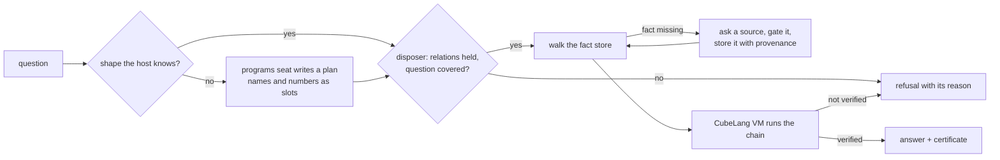

# CubbyLLM

CubbyLLM is an architecture that answers with proof or says it does not know. A language model inside it proposes
how to answer a question, as a short program, and the host checks that the program covers the question. CubeLang,
our verifying VM, then runs it against a fact store and returns the answer with the statements it rests on, or a
refusal with its reason. The model is the most replaceable layer of the stack, and it never judges its own work.

What this gives you is an answer you can check. Every answer Cubby speaks carries a certificate naming the facts it
read and the store they came from, and anyone you hand that answer to can confirm it is genuine and unchanged.

## Why we built it this way

Language models answer first, and nothing checks the answer before it is given. Retrieval puts documents in the
prompt, however the model still writes the final string, so a citation tells you where the model looked and not that
the answer follows from what it read. Tool use is closer to a solution, as a calculator or a search call computes
the part a model would otherwise guess, but the model still decides what to call and how to read what comes back. We
took the opposite position: the model proposes, the host disposes, and every sentence Cubby says about the world
leaves through a program the VM ran against a store.

Note that this makes Cubby quiet: it refuses most open-domain questions today, and the measurements below say why,
but what it does say comes with a trace a person can read step by step. Certified is also not correct, since a
certificate proves the answer follows from the statements in the store: when a statement is wrong, the answer is
wrong with a faithful certificate, and we count it as wrong.

## How a question is answered



The host reads the question first, and a question about Cubby itself, about how two people are related, about a
mounted scene, or of an everyday shape it already knows ("what is the capital of France?") gets its plan from rules.
On a 20-question bench of 24 October, the questions planned by rules took a median of 0.07 s, the lookup and the VM
check included. Every other question goes to the programs seat, an adapter on our own 450M trunk, which writes the
plan in slot form. The host marks the question's names and numbers as slots (`[E1: Marie Curie]`, `[N1: 48]`) and the
program can only point at them, so the model never copies a name or a number. A program naming a slot it was not
given is refused before it runs. That path took a median of 2.74 s on the same bench, nearly all of it the seat
writing.

The disposer then checks that the store holds every relation the plan names and that the plan covers the question,
the walk reads the facts, and the VM runs the chain and checks each hop. A fact the store lacks can be learned on the
spot, as the host asks a source, gates what comes back, stores it with its provenance and walks again.

## The layers

| layer | what it is | what it does for you |
|---|---|---|
| compute | `grilly2`, the torch API on Vulkan (on PyPI as `grilly2`) | Cubby runs on consumer AMD and Intel cards, and on Colab's NVIDIA cards through the same path |
| representation | one VSA algebra, sparse block codes; text encoded with no neural model in the path | a lookup is exact algebra, not a guess |
| the VM | CubeLang: Rust, deny-by-default, verify-before-execute | one component, not a model, decides whether an answer follows from the store |
| the boundary | only (symbol, similarity) crosses into the VM, never raw vectors | what gets checked is always a named fact |
| worlds | the fact store (`FactStore`, `TripleIndex`) over Wikidata's dump, books, an encyclopedia and news; MoWM | knowledge you update by editing one fact, each with where it came from |
| reasoning | the planner, the disposer, the walk, search-and-learn, the rule library, the step loop | answers over several facts, checked hop by hop |
| the host | the brain: neurochemistry, routing, the cortices, the checks on every reply | a conversation partner whose claims all go through the VM |
| the trunk | base450m and its LoRA roles | proposes plans and words the replies; replaceable |

## Our model

base450m is GRL's own trunk, a hybrid of MinGRU recurrence and windowed attention (hidden size 1024, 32 layers,
attention over a 512-token window every third layer, a 128,000-token vocabulary). It has 576M trainable parameters,
314M of them in the trunk and the rest in the embedding table and the output head. It has read 7.57B tokens, 2.77B in
its first run and 4.80B in a continuation, each on one Colab A100, and it runs at home on grilly2 on an RX 6750 XT.
One base carries the LoRA adapters of every role, swapped in place: the programs seat and the talk seat today. The
LFM2.5-2.6B stand-in still sits behind the same interface, as the control arm.

The model is small on purpose, because facts live in the store: the trunk only has to learn language and planning,
and a fact is written once instead of being seen until the weights keep it. On a 1.06M-parameter trunk of ours trained
on 1,000 synthetic facts, exact recall was 0.50 after 100 sightings of a fact and 0.99 after 1,000 (H-K7). The next
base run (order 0045) reads about 10.8B more tokens.

## Where it stands, 24 November 2026

Every row says who proposed the answers, and each number has its log in `validation/logs/` and its entry in
`CUBBYLLM_HYPOTHESES.md` or an order in `docs/orders/`.

| set | who proposed | spoken | wrong among spoken | refused |
|---|---|---:|---:|---:|
| CLUTRR kinship, 2 to 10 hops, 1,146 questions (H-A13) | no language model: 109 rules learned in one night from refused questions | 827 | 0 | 319 |
| the same, 4 to 10 hops, depths no training record reaches, 1,003 | the same rules | 746 | 0 | 257 |
| SimpleQA, 4,326 (order 0054) | the host's rules, the rule library and the 450M programs seat, over Wikidata's dump of 29 December 2025 | 6 | 0 | 4,320 |
| Natural Questions (open), 3,610 | the same | 13 | 2 (+1 debatable) | 3,597 |
| WebQuestions, 2,032 | the same | 62 | 1 (+2 debatable) | 1,970 |
| AA-Omniscience, 600 | the same | 0 | none spoken | 600 |
| 236 word problems never trained on (H-E19) | the 450M, one VM-run step at a time, said only when the 2.6B stand-in's own program agrees | 55 | 2 | 181 |
| 600 free-text questions over entities never trained on, built from the store's chains, 3 seeds | the 2.6B stand-in's programs seat (`emitter_v13e`) | 599 / 600 / 600 | 0 | 1 / 0 / 0 |
| 300 reworded questions about chains seen before (exp_r13) | no model: plans recalled from memory | 272 | 0 | 28 |

The open-domain rows run with order 0066's four answer checks on. The checker holds where the plans and the facts
are there, with 0 wrong on CLUTRR at depths no training record reaches and on the free-text sets built from the
store. On open questions it is not perfect, as 3 of the 81 spoken answers are wrong and 3 are debatable. Before those
checks, 2 of the 8 wrong answers were Wikidata's own value against the benchmark's gold (the year a podcast started,
the year a strike ended), so the certificate was faithful and the answer still wrong. Without the VM, the same
proposals would have said 11 SimpleQA answers with 3 wrong, 16 Natural Questions answers with 4 wrong and 105
WebQuestions answers with 10 wrong and 2 debatable (arm C−VM of order 0054, before the checks).

The main problem now is the proposer, not the checker: on SimpleQA, 3,759 of the 4,326 questions never became a plan
the store could answer. Order 0081 tried the simplest fix, a seat
that can only name relations the store holds, and it was killed: on 600 held-out questions the 450M answered 198
without it and 188 with it, 0 wrong on both, because the gate reads the question's own word ("born") and the
constraint took that word away. Order 0082 trains the seat on a second writer's
wordings, which in September raised the 450M's plans on unseen wordings from 0.225 to 0.495 (H-E18). On arithmetic,
the 2.6B stand-in alone gets 85.2% of the same 236 problems right in one pass and says a wrong answer on 14.8% of
them, while the 450M alone, one step at a time, gets 22.9%. GSM8K's own test is order 0078 and has not been read.

We also measured what a model's memory is worth as a source. Asked for the facts behind 600 SimpleQA questions, the
2.6B stand-in produced 7 answers Cubby held back, and all 7 were wrong; against Wikidata it agreed on 1 fact and
disagreed on 28. This is why a fact a model remembers is stored as latent and never spoken until a second source
states it. The tables of September and October are in `docs/RESULTS.md`.

## What is new in it

| idea | what it does for you | over a conventional model |
|---|---|---|
| slots (H-E15): the host places every name and number, the program only points at them | the name in the answer is the one you wrote, never a near-miss spelling | a model copies names and numbers token by token and can garble them |
| the disposer and named refusals (`plan_verify`) | when Cubby cannot answer, it says which step stopped: no plan, a relation it does not hold, a name it cannot resolve, a missing fact | a model rarely knows why it does not know |
| certificates anyone can check (order 0076: CheezML's Comté protocol for answers, Maasdam for refusals) | you, or anyone you forward an answer to, can confirm it is genuine and unchanged | a citation cannot be checked against what the model read |
| search and learn (`reasoning/learn.py`) | a fact Cubby lacked is fetched, gated and stored with its source, and it is still known tomorrow | a model is retrained to learn a fact, and keeps no record of where it came from |
| the latent tier | what a model remembers is kept, and never said until a second source agrees | a model's memory is spoken as fact |
| arithmetic one step at a time (H-E19) | every number in a worked answer was computed by the VM | arithmetic in a model's head makes slips that look like answers |
| the rule library (H-A13) | family-relation questions answered at depths it was never shown, with 0 wrong | a model's accuracy falls with the number of hops |
| the loci link (H-K10): a token bound to its place in the input, read back by algebra inside the trunk | the 450M recalls a fact it was shown once, more than 800 tokens earlier: 0.946 exact on 2,002 held-out questions, up from 0.021, by training 1,027 parameters, its 21 text sources within 0.005 of before | a model adds knowledge by fine-tuning every weight, or by a longer context |
| the 128k vocabulary at a 32k head's cost (order 0068, route 5) | a large vocabulary without paying for it at every word: a decode step of 21.603 ms against 21.686 for a 32,000-word head and 22.759 for the full head, the full head's word on 99.76% of held-out positions | a bigger vocabulary costs every token |
| one VM per user (exp_r20) | your session's facts and programs are walled off from everyone else's, at 1.69 MB and 19 ms a session | isolating users usually means a container or a process each |
| a memory of checked plans (the hippocampus; on the serve path with order 0083) | a question Cubby has answered before comes back fast, checked again | a cache returns text it cannot re-check |

Two more are in progress: order 0079 gives Cubby its own voice in conversation, with every reply checked for facts,
feelings and abilities it does not have. Order 0080 makes a reply to someone in distress stay with them and point to
help. The 128k route and the loci link are off by default until their serving checks pass (orders 0083 and 0052).

## The invariants

1. **The VM is the only truth gate.** No LLM-as-judge anywhere in the loop; the model never scores its own thoughts.
2. **The model proposes, the host disposes.** Identity, provenance, execution, reward, retirement, and what the model
   is shown are host decisions.
3. **The don't-know contract.** An unverified claim is never spoken.
4. **Retire, never delete.** Every record carries a store-snapshot hash and a git revision.
5. **Serve-time budget.** A small model on a 12 GB GPU, VM calls in milliseconds, an adapter round on one 80 GB GPU in
   tens of minutes.
6. **No self-play or self-judging shortcuts.**
7. **Ported, never linked.** No code reaches into a sibling checkout at runtime; grilly2 comes in as an installed
   package, through `cubbyllm/ops/` only.

## Run it

With Python 3.12 or later, `pip install -e .` installs the two packages (their dependencies are not declared yet:
numpy, and torch for training), and `pip install grilly2` brings the Vulkan runtime for the 450M. A built CubeLang
binary is needed (`cargo build --release` in the CubeLang repository), found through `--exe`, `$CUBELANG_EXE`, or a
`cubelang` checkout beside this one. The base, the adapters, the tokenizer and the worlds' data are kept off the
repository.

```
python -m pytest tests -q

python -m cubby_serve --cubby450m <export> --emitter-adapter <dir> --talk-adapter <dir> --ask --web off   # our model
python -m cubby_serve --gguf <stand-in GGUF>                                     # the stand-in, the control arm

python validation/exp_r9_matched_pairs.py --n 200 --resident                     # four wordings of each chain
python validation/exp_r10_simpleqa.py --resident                                 # free text through the whole gate
python validation/exp_he19_step_loop.py --export <grilly export> --adapter <adapter dir> --tokenizer <bbpe128k json> \
    --data <held-out slots jsonl> --tag <tag>                                    # arithmetic, one step at a time
```

Every experiment writes `validation/logs/<name>.{json,log}`, and every number in this README points at one of them.
The training runs are Colab notebooks in `notebooks/`.

## How the work is organized

The research runs as pre-registered hypotheses and work orders. `CUBBYLLM_HYPOTHESES.md` holds every claim with a
kill line written before its run, its dated result, and a rule on held-out sets (section 0). The work orders in
`docs/orders/` are each an argument with its acceptance lines, its kill and its report, `docs/RESULTS.md` keeps the
dated tables this README used to carry, and `docs/research/` holds the longer write-ups. A negative result stays in
the record: the grown model of H-E20 is parked with its reasons, and each killed lever says why it was killed.
`VISION.md` and `docs/ARCHITECTURE_VISION.md` are the north star, and `docs/PATH.md` says what is measured, what
turned out false, and what would prove the whole approach wrong.

```
cubbyllm/      the package (Apache-2.0): reasoning, worlds, sources, speech, affect, emit (the seats), model, ops
cubby_serve/   the product layer (BSL-1.1): the server, the control board, the harness, the fetchers
standin/       the GGUF stand-in and the Cubby-Man game (BSL-1.1)
validation/    the experiments, the trainers, the data builders and the logs (Apache-2.0)
dashboard/     the control panel
notebooks/     the Colab runs
docs/          the orders, the research notes, the papers, RESULTS.md
```

`cubbyllm/` imports neither of the other two packages, opens no socket and edits no `sys.path`
(`tests/test_package_rules.py`).

## Licensing

`cubbyllm/` (what makes Cubby think) and `validation/` (how it is made and measured) are **Apache-2.0** (`LICENSE`).
`cubby_serve/` (the product: the server, the board, the harness, the fetchers) is **Business Source License 1.1**
(`cubby_serve/LICENSE`), and so is `standin/` (the GGUF stand-in and the game; `standin/LICENSE`, change date
2030-09-11 → Apache-2.0). CubeLang carries its own BSL-1.1, and licensing questions go to licensing@grillcheese.ai.

## Where it comes from

CubbyLLM is a fresh design from GRL, the GrillCheese Research Lab, with cubby-lm and cubemind as its direct
predecessors. It ports from its sibling repositories rather than linking to them: CubeLang (the VM), grilly and
grilly2 (Vulkan compute and the VSA substrate), MoWM (Mixture of World Models) and cubemind. The validation campaign
of July 2026 (`VALIDATION_REPORT.md`) set the decisions the trunk is built around, and the stand-in serve stack of
August and September built the host before our own model existed (`standin/README.md`).
